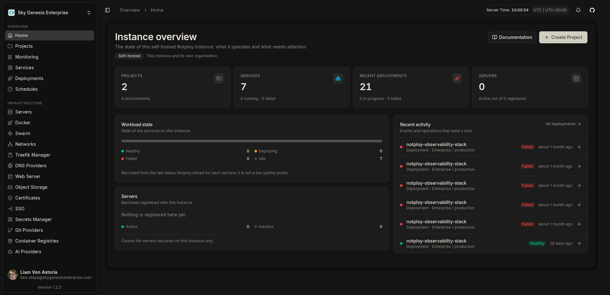
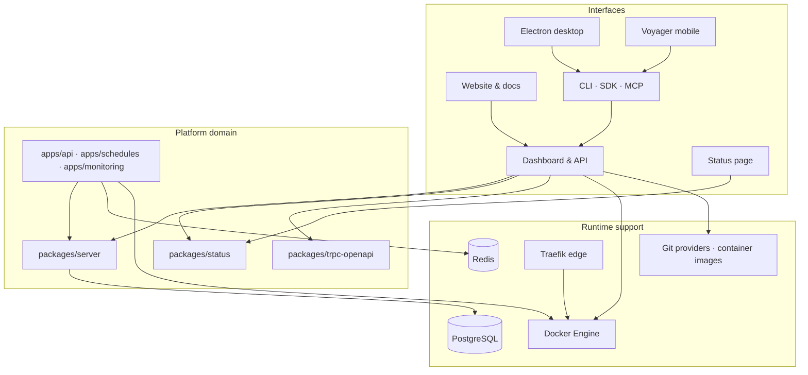

<div align="center">

<h1>Notploy</h1>

<p><strong>The open-source platform for deploying and operating applications.</strong></p>

<p>Applications, databases, Docker Compose projects, servers and clusters. One control plane, a desktop client, a mobile app and the shared foundation that holds them together.</p>

<p>
  <a href="https://notploy.com">Website</a> ·
  <a href="https://docs.notploy.com">Documentation</a> ·
  <a href="https://templates.notploy.com">Templates</a> ·
  <a href="https://status.notploy.com">Status</a> ·
  <a href="https://discord.gg/GUkDugVh34">Discord</a> ·
  <a href="https://github.com/skygenesisenterprise/notploy/issues">Issues</a>
</p>

<p>
  <a href="LICENSE"></a>
  <a href="https://nodejs.org"></a>
  <a href="https://pnpm.io"></a>
  <a href="https://www.typescriptlang.org"></a>
  <a href="https://nextjs.org"></a>
  <a href="https://expo.dev"></a>
  <a href="https://discord.gg/GUkDugVh34"></a>
</p>

  <a href="https://notploy.com">
    
  </a>
  </br>
  </br>

</div>

---

Notploy is an open-source, self-hostable platform for deploying and operating
applications. It is built for platform and DevOps teams, self-hosting enthusiasts
and agencies that want a modern deploy experience without giving up control of
their servers.

Run the control plane on your own infrastructure with Docker Compose or Docker
Swarm, manage it from the web dashboard, the Electron desktop client or the
Voyager mobile app, or use [Notploy Cloud](https://app.notploy.com) for a managed
experience. Every client consumes the same backend through `@notploy/sdk`.

## ✨ Highlights

- **One control plane, three clients.** The web dashboard, the Electron desktop
  client and Voyager for iOS and Android share API contracts through
  `@notploy/sdk`, so behaviour stays consistent across platforms.
- **Your infrastructure, your data.** Notploy runs on your servers, your
  PostgreSQL and Redis, and through your Docker Engine. Nothing is sent to a
  third party unless you configure it.
- **Deploy anything, the way you want.** Ship from Git providers or container
  images using Docker, Nixpacks, Railpack or buildpacks, and target the local
  server, remote servers over SSH, or a Docker Swarm cluster.
- **Databases are first-class.** Provision and operate PostgreSQL, MySQL,
  MariaDB, MongoDB and Redis with scheduled backups, without wiring up separate
  tooling.
- **Secure by default.** Traefik handles routing, domains and certificates;
  secrets stay in environment variables and vaults; organizations and
  permissions restrict access.
- **One image, role-based topology.** The `client` and `api` roles share the
  same image. Only `api` holds database and Redis credentials, applies
  migrations and uses the host Docker socket. `self` and `cloud` are runtime
  editions of that image, not separate products.
- **Automate everything.** Drive deployments from the API, CLI, TypeScript SDK
  or MCP server, so Notploy fits into existing pipelines.
- **Open source and extensible.** Apache-2.0, a single pnpm workspace, reusable
  provider adapters and one-click application blueprints.

## 📦 What's inside

| Product | What it does | Where |
| --- | --- | --- |
| **Control plane** | Dashboard, tRPC/OpenAPI API, auth, WebSockets, workers, migrations | [`apps/notploy`](apps/notploy) |
| **Background services** | Inngest async work, scheduled jobs, Go monitoring service | [`apps/api`](apps/api), [`apps/schedules`](apps/schedules), [`apps/monitoring`](apps/monitoring) |
| **Clients** | Electron desktop shell and the official Voyager mobile app | [`apps/notploy/electron`](apps/notploy/electron), [`apps/voyager`](apps/voyager) |
| **Status product** | Public status page, state computation and notification outbox | [`apps/status`](apps/status), [`packages/status`](packages/status) |
| **Automation interfaces** | CLI, TypeScript SDK, MCP server, GitHub and VS Code integrations | [`packages/`](packages) |
| **Templates** | Blueprint gallery and one-click Docker Compose applications | [`templates/`](templates) |
| **Web properties** | Marketing website and documentation site with their own workspace | [`web/`](web) |

## 🧱 Project support structure

Notploy is organized as **support layers**. Each layer has one job and depends
only on the layer beneath it. This keeps the control plane, three clients, the
status product and two web properties releasable without turning the repository
into one coupled application.



| Layer | Location | Owns | Depends on |
| --- | --- | --- | --- |
| **Interfaces** | `apps/notploy`, `apps/status`, `apps/voyager`, `packages/mcp` | Screens, HTTP surfaces, docs, AI tools | `@notploy/sdk`, platform domain |
| **Platform services** | `apps/api`, `apps/schedules`, `apps/monitoring` | Background jobs, schedules, metrics collection | Domain packages, PostgreSQL, Redis |
| **Platform domain** | `packages/server`, `packages/status`, `packages/trpc-openapi` | Persistence, auth support, status state, API contracts | Runtime libraries only |
| **Contract layer** | `packages/sdk`, `packages/github` | Generated API client, repositories, deployments, webhooks | tRPC/OpenAPI contracts |
| **Templates** | `templates/app`, `templates/blueprints` | Blueprint gallery, metadata and validation | Independent Vite toolchain |
| **Web foundation** | `web/` | Website, documentation site, Dockerfiles, Makefile | React / Next.js ecosystem |
| **Support tooling** | `scripts/`, `docker/`, `install.sh`, `Makefile`, `.github/` | Install, worktrees, docs checks, CI, publishing | Repository tools |

### Repository map

```text
notploy/
├── apps/                         # Platform products and clients
│   ├── notploy/                  # @notploy/app — dashboard, API, runtime, Electron shell
│   ├── api/                      # @notploy/api — Inngest background work, port 4000
│   ├── schedules/                # @notploy/schedules — scheduled jobs, port 4001
│   ├── status/                   # @notploy/status-app — public status page, port 4100
│   ├── monitoring/               # Go metrics service (outside the pnpm workspace)
│   └── voyager/                  # @notploy/voyager — Expo mobile app
├── packages/
│   ├── server/                   # Platform domain, persistence, auth utilities
│   ├── sdk/                      # Generated TypeScript API client
│   ├── cli/                      # Command-line interface
│   ├── mcp/                      # Model Context Protocol server
│   ├── github/                   # GitHub App, repositories, checks, webhooks
│   ├── trpc-openapi/             # tRPC ↔ OpenAPI bridge
│   ├── status/                   # Status engine, APIs, notification outbox
│   ├── browser/                  # Browser integration helpers
│   ├── vscode/                   # VS Code extension
│   └── discord/                  # Community Discord bot
├── web/                          # Separate workspace: website, docs, Dockerfiles, Makefile
├── templates/
│   ├── app/                      # @notploy/templates-app — gallery frontend
│   ├── blueprints/               # One-click Docker Compose applications
│   └── build-scripts/            # Validation and metadata generation
├── examples/                     # Standalone examples (outside the pnpm workspace)
├── docker/                       # Deployment-tooling install helper
├── scripts/                      # Install, worktree, ports and docs tooling
├── .github/                      # CI workflows, templates and support files
├── Dockerfile                    # dev / status / platform targets
├── entrypoint.sh                 # Runtime role selection: api | client | migrate | status
├── docker-compose.yml            # Stack: postgres, redis, traefik, client, api
├── Makefile                      # Thin wrapper over pnpm, Docker and scripts
├── .env.example                  # Platform environment template
├── install.sh                    # Guided installation script
├── pnpm-workspace.yaml           # Workspace and dependency catalog
└── pnpm-lock.yaml                # Single root lockfile
```

### Dependency rules

1. Applications consume domain packages; domain packages never import
   applications.
2. Applications do not import each other. Shared behaviour belongs in a
   package.
3. Every client talks to the backend through `@notploy/sdk` and never opens a
   database connection of its own.
4. Only the `api` role holds database and Redis credentials, applies migrations
   and mounts the host Docker socket. The `client` role has none of them.
5. `web/` and `templates/` are independent build targets and can be built
   without the platform.
6. The Go monitoring service and `examples/` intentionally stay outside the
   pnpm workspace.
7. Secrets stay at the edge; they are never committed, and structured logs
   redact token and secret-shaped values.
8. Deployed workloads share the long-lived `notploy-network` with Traefik, but
   they are not part of the control-plane image.

### Data ownership

| Store | Owner | Contents |
| --- | --- | --- |
| PostgreSQL | `apps/notploy` / `packages/server` | Users, organizations, servers, deployments, managed databases, audit and platform settings |
| Redis | `apps/api`, `apps/schedules`, `apps/notploy` | Cache, BullMQ queues, coordination |
| `notploy-config` volume | `api` role and Traefik | Generated dynamic routes and edge configuration |
| Application volumes | Notploy-managed workloads | Data belonging to deployed applications and databases |
| Status persistence | `packages/status` / `apps/status` | Status components, incidents, maintenance windows and notification outbox |

### Client applications

| Path | Role |
| --- | --- |
| `apps/notploy` (Electron shell) | Desktop client packaged with `electron-builder` from `apps/notploy/electron` via the `desktop:*` scripts |
| `apps/voyager` | Official mobile application (Expo 58 / React Native) |

## 🖥️ Platform

| Path | Package | Role |
| --- | --- | --- |
| `apps/notploy` | `@notploy/app` | Next.js dashboard, Node API server (tRPC/OpenAPI, better-auth, WebSockets, workers), migrations, optional desktop shell |
| `apps/api` | `@notploy/api` | Inngest background work and HTTP triggers, port 4000 |
| `apps/schedules` | `@notploy/schedules` | BullMQ scheduled and recurring jobs, port 4001 |
| `apps/status` | `@notploy/status-app` | Standalone public status page, port 4100 |
| `apps/monitoring` | Go module | Host/container metrics, thresholds and callback notifications, port 3001 |

`apps/notploy` is the control-plane composition root: it consumes
`@notploy/server`, `@notploy/status` and `@notploy/trpc-openapi`, and it is the
only application that applies platform migrations.

| Package | Role |
| --- | --- |
| `@notploy/server` | Domain logic, Drizzle schema and migrations, auth support, integrations |
| `@notploy/sdk` | Generated TypeScript API client shared by every client |
| `@notploy/cli` | Command-line interface |
| `@notploy/mcp` | Model Context Protocol server over stdio, HTTP or SSE |
| `@notploy/github` | GitHub App authentication, repositories, deployments, checks and webhooks |
| `@notploy/trpc-openapi` | tRPC ↔ OpenAPI adapter |
| `@notploy/status` | Status domain, state computation, persistence, APIs, notification outbox |
| `@notploy/discord` | Read-only, community-facing Discord bot built on the SDK |
| `notploy` | VS Code extension for Notploy management |

The root Compose stack runs exactly five service groups: `postgres`, `redis`,
`traefik`, `client` and `api`. The client and API build the same image; only the
API holds credentials, applies migrations and needs the host Docker socket.
PostgreSQL, Redis and the internal API endpoint are never published.

### Web properties and templates

`web/` is a separate pnpm workspace with its own Makefile, Compose file and
Dockerfiles:

| Path | Package | Role | Dev port |
| --- | --- | --- | --- |
| `web/apps/website` | `@notploy/website` | Marketing site | 3000 |
| `web/apps/docs` | `@notploy/docs` | Product documentation and generated API references | 3001 |

`templates/` holds the Vite blueprint gallery, the Docker Compose blueprints and
their validation scripts. The gallery deploys independently to Cloudflare Pages
at `templates.notploy.com`; see [`templates/README.md`](templates/README.md).

## 🧰 Technology

| Area | Stack |
| --- | --- |
| Control plane | TypeScript 7, Next.js 16, tRPC 11, OpenAPI, better-auth, Drizzle ORM, Zod |
| Runtime | Node.js 24, PostgreSQL 16, Redis 7, BullMQ, Inngest |
| Clients | Electron / `electron-builder`, Expo 58, React 19, Tailwind CSS 4 |
| Deployment | Docker, Docker Compose, Docker Swarm, Traefik, Nixpacks, Railpack, buildpacks, SSH |
| Monitoring | Go service with thresholds and callback notifications |
| Web | Next.js 16, Tailwind CSS, dedicated pnpm workspace |
| Quality | Biome, Vitest, TypeScript, CodeQL, dependency review |

## ⚡ Quick start

### Prerequisites

- **Node.js 24.4+** (`.nvmrc` pins `24.4.0`) and **pnpm 12**
  (`packageManager` pins `12.23.0`)
- **Docker Engine** with the Compose plugin for containers
- **PostgreSQL** and **Redis** only for local development without Compose
  (Compose provides both)
- **Go 1.21+** only for `apps/monitoring`

The fastest way to install Notploy:

```bash
curl -sSL https://notploy.com/install.sh | sh
```

After installation, open [http://localhost:3000](http://localhost:3000) to
complete the setup.

### Run the platform from source

```bash
git clone https://github.com/skygenesisenterprise/notploy.git
cd notploy
cp .env.example .env
```

Set `POSTGRES_PASSWORD`, `REDIS_PASSWORD` and `BETTER_AUTH_SECRET` in `.env`.
Generate each secret with `openssl rand -hex 32`. Then:

```bash
make docker-up self
make docker-logs
```

`make docker-up self` builds the image and starts the `prod` profile. The direct
Compose equivalent is `docker compose --profile prod up -d --build`. The
Compose services need a profile, so a plain `docker compose up` starts nothing.
The host Docker socket is mounted into the `api` role only; treat that
permission as highly privileged.

| Service | URL |
| --- | --- |
| Dashboard | [http://localhost:3000](http://localhost:3000) |
| API and WebSockets | [http://localhost:4000](http://localhost:4000) |
| Traefik HTTP / HTTPS | [http://localhost:80](http://localhost:80) / `https://localhost:443` |
| Traefik dashboard | [http://localhost:8080](http://localhost:8080) |
| Status page (standalone `status` target) | [http://localhost:4100](http://localhost:4100) |
| DNS server (dev host port) | `5300/udp` and `5300/tcp` (`53` in production) |

PostgreSQL and Redis stay internal. Keep `.env` private, and do not expose the
dashboard publicly before authentication and HTTPS are configured. For
production installation, updates, networking and TLS, follow the
[installation documentation](https://docs.notploy.com/docs/core/installation).

Useful operations:

```bash
make docker-ps
make logs SERVICE=api
make docker-down
```

`make docker-down` preserves the named data volumes and the external
`notploy-network`. Do not remove them if deployed workloads or your Notploy
database must survive a restart.

## 🛠️ Development

```bash
pnpm install --frozen-lockfile
```

| Command | What it runs |
| --- | --- |
| `pnpm dev` | Dashboard/API server in development |
| `pnpm build` / `pnpm build:app` | Recursive workspace build / main application build |
| `pnpm test` | Application test suite |
| `pnpm typecheck` | Recursive TypeScript type-check |
| `pnpm lint` | Recursive Biome checks |
| `pnpm setup` | Platform database setup and migrations |
| `pnpm generate:openapi` | Regenerate the OpenAPI specification |
| `pnpm docs:check` | Validate documentation specs, regions and links |
| `pnpm docs:dev` / `pnpm docs:build` | Documentation site |
| `pnpm web:dev` / `pnpm web:build` | Marketing website |
| `pnpm templates:dev` / `pnpm templates:build` | Template gallery |
| `pnpm server:dev` / `pnpm server:build` | `@notploy/server` package |
| `pnpm desktop:dev` / `pnpm desktop:package` | Electron desktop client |
| `pnpm changeset` | Add a changeset for a user-facing change |

### Platform services

```bash
pnpm --filter=@notploy/api run dev
pnpm --filter=@notploy/api run dev:inngest
pnpm --filter=@notploy/schedules run dev
pnpm --filter=@notploy/status-app run dev
```

### Client applications

```bash
cd apps/notploy && pnpm dev          # web dashboard

pnpm desktop:dev                     # Electron client, from the repository root
pnpm desktop:package                 # build the distributable

cd apps/voyager
pnpm dev          # start Expo
pnpm android      # Android emulator
pnpm ios          # iOS simulator
pnpm build        # prebuild native projects
```

The application needs PostgreSQL and a filled-in `.env`. Use the Compose stack
above for a ready-to-run local database; see `.env.example`, the
[installation guide](https://docs.notploy.com/docs/core/installation) and each
package's scripts for service-specific commands.

### Web properties

```bash
make -C web dev web
make -C web dev docs
make -C web build
```

### Discord community bot

The community bot in `packages/discord` exposes read-only slash commands and
talks to Notploy through `@notploy/sdk`; it never touches the control plane
directly.

```bash
pnpm --filter=@notploy/discord run dev
pnpm --filter=@notploy/discord run commands:register
pnpm --filter=@notploy/discord run test
```

See [`packages/discord/README.md`](packages/discord/README.md) for
configuration and deployment.

### Checks

```bash
pnpm lint
pnpm typecheck
pnpm test
pnpm docs:check
```

## 🚀 Deployment

### Images

| Product | Image |
| --- | --- |
| Platform (`self` / `cloud`) | `ghcr.io/skygenesisenterprise/notploy` |
| Status page | Built from the root Dockerfile `status` target |
| Website / docs | Separate images under `web/` |
| Template gallery | Deployed to Cloudflare Pages |

The root Dockerfile supports `dev`, `status` and `platform` targets; `platform`
is the default. One image serves every runtime role, selected with
`NOTPLOY_ROLE=client`, `api`, `migrate` or `status`. The `self` and `cloud`
editions share that image and differ only by environment, build args and a
signed entitlement for cloud — never by service topology.

### Configuration

| Scope | Template | Required values |
| --- | --- | --- |
| Platform | `.env.example` | `POSTGRES_PASSWORD`, `REDIS_PASSWORD`, `BETTER_AUTH_SECRET`; optional OAuth providers |
| Compose | `docker-compose.yml` | `NOTPLOY_APP_HOST` for public routing; optional port overrides |

Typical variables:

| Variable | Purpose |
| --- | --- |
| `NOTPLOY_PORT` / `NOTPLOY_API_PORT` | Published dashboard / API ports (3000 / 4000) |
| `NOTPLOY_BUILD_TARGET` | `platform` in production, `dev` for hot reload |
| `NEXT_PUBLIC_API_URL` | Browser-facing API origin used for WebSockets |
| `BETTER_AUTH_URL` / `BETTER_AUTH_TRUSTED_ORIGINS` | Authentication origin and allowed origins |
| `NOTPLOY_DNS_SERVER` / `NOTPLOY_DNS_UPSTREAM` | Built-in DNS server and its upstream resolvers |
| `OAUTH_GITHUB_*`, `OAUTH_GOOGLE_*`, `OAUTH_DISCORD_*` | Optional sign-in providers |
| `IS_CLOUD` / `NOTPLOY_FLAVOR` / `NOTPLOY_PRODUCT` | Edition flags; set them with `make docker-up self|cloud`, not by hand |

Secrets belong only in `.env` files or the deployment secret store. They are
never committed, and logs redact token and secret-shaped values.

## 📈 Operations

- **Health checks** — role-aware probes through `entrypoint.sh healthcheck` on
  both application containers.
- **Structured logs** — `make docker-logs` or `make logs SERVICE=api`.
- **Migrations** — applied once by the `api` role at startup; disable with
  `NOTPLOY_RUN_MIGRATIONS=0` when another process owns them.
- **Edge routing** — Traefik reads its dynamic configuration from the shared
  `notploy-config` volume; deployed applications join `notploy-network`.
- **Backups** — `make backup` prints the commands to archive the PostgreSQL data
  volume; back up deployed application volumes separately.
- **Updates** — `make update` pulls the revision, refreshes images and restarts
  the stack. Use `make doctor` to check the installation.
- **Editions** — `make docker-up self` (default) or `make docker-up cloud`
  (requires a signed entitlement). Both use the same image.
- **Development stack** — `make docker-dev [self|cloud]` runs the containerized
  dev servers with hot reload.

```bash
make help
make doctor
make status
make restart
```

## 📚 Documentation and support

| Resource | Link |
| --- | --- |
| Product documentation | [docs.notploy.com](https://docs.notploy.com) |
| Website | [notploy.com](https://notploy.com) |
| Template gallery | [templates.notploy.com](https://templates.notploy.com) |
| Hosted platform | [app.notploy.com](https://app.notploy.com) |
| Desktop client | [`apps/notploy/electron`](apps/notploy/electron) |
| Mobile app | [`apps/voyager`](apps/voyager) |
| MCP server | [`packages/mcp`](packages/mcp) |
| Monitoring | [`apps/monitoring`](apps/monitoring) |
| Status engine | [`packages/status`](packages/status) |
| Community | [Discord](https://discord.gg/GUkDugVh34) |
| Bugs and requests | [GitHub Issues](https://github.com/skygenesisenterprise/notploy/issues) |
| Commercial support | [Sky Genesis Enterprise](https://skygenesisenterprise.com) |

### Common questions

| Question | Answer |
| --- | --- |
| Is Notploy free? | Yes. The core platform is Apache-2.0 and the self-hosted edition is free to run. Some separately published components may carry their own license. |
| Do I have to host it myself? | No. Use `make install` or Docker Compose, or choose [Notploy Cloud](https://app.notploy.com). |
| What do I need? | Docker Engine with the Compose plugin for the stack; Node.js 24.4+ and pnpm 12 for development, plus PostgreSQL for host-side development. |
| Where is the documentation? | [docs.notploy.com](https://docs.notploy.com); deployment and feature guides are linked throughout this README. |
| How do I get help? | Ask on [Discord](https://discord.gg/GUkDugVh34) or open a [GitHub issue](https://github.com/skygenesisenterprise/notploy/issues). Never report a vulnerability in a public issue. |

### Common checks

| Symptom | First place to look |
| --- | --- |
| `docker compose up` starts nothing | Services require a profile; use `make docker-up self` or `--profile prod`. |
| The stack fails on a bind error | A host port is busy — check `NOTPLOY_PORT`, `NOTPLOY_API_PORT`, `NOTPLOY_DNS_HOST_PORT`, 80, 443 and 8080. |
| The API refuses to start | Missing `POSTGRES_PASSWORD`, `REDIS_PASSWORD` or a weak `BETTER_AUTH_SECRET` in `.env`. |
| The dashboard loads but WebSockets fail | `NEXT_PUBLIC_API_URL` is baked into the browser bundle; rebuild after changing it. |
| Deployed applications lose routing | The external `notploy-network` or the `notploy-config` volume was removed. |
| A client drifts from the backend | Regenerate `@notploy/sdk` after changing the API contract. |

## 🤝 Contributing

Contributions are welcome. Read the [Code of Conduct](CODE_OF_CONDUCT.md) and the
[contribution guide](.github/CONTRIBUTING.md), keep pull request titles in
Conventional Commits format, and add a changeset for user-facing changes.

```bash
pnpm lint
pnpm typecheck
pnpm test
pnpm docs:check
```

Please never paste credentials, tokens or customer data into an issue or pull
request.

## 🔒 Security

Do not report vulnerabilities in public issues. Follow the private reporting
instructions in [`SECURITY.md`](SECURITY.md).

## 📄 License

The repository is licensed under the [Apache License 2.0](LICENSE). Some
packages or included components may carry their own license; check the relevant
package's license before redistributing it.

---

<div align="center">

Maintained by [Sky Genesis Enterprise](https://skygenesisenterprise.com).

</div>
