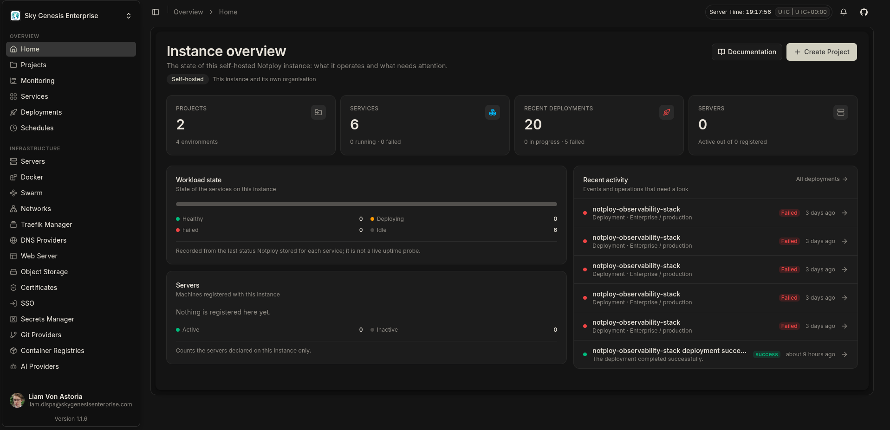

# Notploy

[](LICENSE)
[](https://nodejs.org)
[](https://pnpm.io)
[](https://typescriptlang.org)
[](https://expo.dev)
[](.github/CONTRIBUTING.md)
[](https://discord.gg/GUkDugVh34)

<div align="center">
  <a href="https://notploy.com">
    
  </a>
  </br>
  </br>
</div>
<br />

> Deploy and operate applications on infrastructure you own.

**Notploy** is an open-source, self-hostable platform for deploying and operating applications. It provides a web control plane for application and database deployments, Docker Compose projects, servers and clusters. Run it on your own infrastructure with the full Notploy suite, access it from the **Desktop** client, use the **Voyager** mobile app on the go, or leverage [Notploy Cloud](https://app.notploy.com) for a managed experience.

**Perfect for:** platform and DevOps teams, self-hosting enthusiasts, agencies running client infrastructure, and any team that wants a modern deploy experience without giving up control of the servers.

## Contents

- [Notploy](#notploy)
  - [Contents](#contents)
  - [Why Notploy matters](#why-notploy-matters)
  - [What you can do](#what-you-can-do)
    - [Deploy](#deploy)
    - [Operate](#operate)
    - [Automate](#automate)
    - [Scale](#scale)
  - [Quick start](#quick-start)
    - [Self-host with Docker Compose](#self-host-with-docker-compose)
  - [How Notploy is built](#how-notploy-is-built)
    - [Workspace layout](#workspace-layout)
    - [Core services](#core-services)
    - [Client applications](#client-applications)
    - [Shared packages](#shared-packages)
    - [Web properties](#web-properties)
    - [Templates \& examples](#templates--examples)
  - [Development](#development)
    - [Root commands](#root-commands)
    - [Client application development](#client-application-development)
    - [Web properties](#web-properties-1)
    - [Discord community bot](#discord-community-bot)
  - [FAQ](#faq)
    - [Is Notploy free?](#is-notploy-free)
    - [Do I have to host it myself?](#do-i-have-to-host-it-myself)
    - [What do I need to run it?](#what-do-i-need-to-run-it)
    - [Where is the documentation?](#where-is-the-documentation)
    - [How do I get help or report a bug?](#how-do-i-get-help-or-report-a-bug)
  - [Related resources](#related-resources)
    - [Official](#official)
    - [Community](#community)
    - [Commercial](#commercial)
  - [Contributing](#contributing)
  - [Security](#security)
  - [License](#license)
  - [Note](#note)

## Why Notploy matters

🎯 **You own the infrastructure** — Notploy runs on your servers, your network and your database. Nothing is locked into a managed platform, and the source is yours to audit.

🚀 **Deploy anything, the way you want** — Ship from Git providers or container images using Docker, Nixpacks, Railpack or buildpacks, and target the local server, remote servers over SSH, or a Docker Swarm cluster.

📦 **Databases are first-class** — Provision and operate PostgreSQL, MySQL, MariaDB, MongoDB and Redis with scheduled backups, without wiring up separate tooling.

🔒 **Secure by default** — Route traffic through Traefik with managed domains and certificates, keep secrets in environment variables and vaults, and restrict access with an organization and permission model.

🧩 **Automate everything** — Drive Notploy from the API, CLI, TypeScript SDK or MCP server, so deployments fit into existing pipelines instead of replacing them.

🤝 **Open source and extensible** — The platform is Apache 2.0, self-hostable, and designed around reusable provider adapters and one-click blueprints.

## What you can do

### Deploy

- Deploy applications from Git providers or container images using Docker, Nixpacks, Railpack, or buildpacks.
- Run Docker Compose projects and manage their services, configuration, logs and deployments.
- Browse one-click application blueprints in the [Notploy Templates gallery](https://templates.notploy.com).

### Operate

- Provision and operate PostgreSQL, MySQL, MariaDB, MongoDB and Redis databases, with scheduled backups.
- Route applications with Traefik, manage domains and certificates, and configure environment variables, volumes and resource limits.
- Monitor resource usage and logs, and send deployment notifications to supported providers.

### Automate

- Automate operations with the Notploy API, CLI, TypeScript SDK, or MCP server.

### Scale

- Deploy to the local server, independent remote servers over SSH, or a Docker Swarm cluster.

See the [feature guide](https://docs.notploy.com/docs/core/features) and [deployment options](https://docs.notploy.com/docs/core/deployment-options) for details.

## Quick start

The easiest way to install Notploy:

```bash
curl -sSL https://notploy.com/install.sh | sh
```

After installation, open [http://localhost:3000](http://localhost:3000) to complete setup.

### Self-host with Docker Compose

Requirements: Docker Engine with the Compose plugin. The self-hosted container needs access to the host Docker socket to build and manage workloads; treat this permission as highly privileged.

```bash
git clone https://github.com/skygenesisenterprise/notploy.git
cd notploy
cp .env.example .env
```

Edit `.env` before starting the stack. Set unique values for `POSTGRES_PASSWORD` and `BETTER_AUTH_SECRET` (for example, generate each with `openssl rand -hex 32`), then start Notploy:

```bash
docker compose up --build -d
docker compose logs -f notploy
```

Open [http://localhost:3000](http://localhost:3000) and complete the initial setup. Keep the `.env` file private and do not expose the dashboard publicly until you have configured authentication and HTTPS. For production installation, updates, networking and TLS guidance, follow the [installation documentation](https://docs.notploy.com/docs/core/installation).

Useful Compose commands:

```bash
docker compose ps
docker compose logs -f
docker compose down
```

`docker compose down` preserves the named data volumes. Do not remove them if you need to keep your Notploy database and configuration.

## How Notploy is built

Notploy is a pnpm monorepo with a single root lockfile (`pnpm-lock.yaml`) and workspace definition (`pnpm-workspace.yaml`) spanning the core services, shared packages, web properties and the template tooling. The Go monitoring service (`apps/monitoring`) and the standalone examples (`examples/`) intentionally live outside that workspace.

### Workspace layout

```text
notploy/
├── apps/                    # Core services and the desktop-capable application
│   ├── notploy/             # @notploy/app — dashboard, API server, runtime, Electron desktop
│   ├── api/                 # @notploy/api — async/background work service (Inngest)
│   ├── schedules/           # @notploy/schedules — scheduled jobs
│   ├── status/              # @notploy/status-app — public status page (Next.js)
│   ├── monitoring/          # Go monitoring service (outside the pnpm workspace)
│   └── voyager/             # @notploy/voyager — official Expo mobile app
├── packages/                # Shared libraries
│   ├── server/              # @notploy/server
│   ├── sdk/                 # @notploy/sdk
│   ├── cli/                 # @notploy/cli
│   ├── mcp/                 # @notploy/mcp
│   ├── github/              # @notploy/github
│   ├── trpc-openapi/        # @notploy/trpc-openapi
│   ├── status/              # @notploy/status
│   ├── vscode/              # notploy — VS Code extension
│   └── discord/             # @notploy/discord — official Discord bot
├── web/                     # Marketing website + docs (own Makefile, Dockerfiles, compose)
│   ├── apps/website/        # @notploy/website
│   └── apps/docs/           # @notploy/docs
├── templates/               # Template gallery, blueprints and validation scripts
│   ├── app/                 # @notploy/templates-app
│   ├── blueprints/          # One-click application blueprints
│   └── build-scripts/       # @notploy/templates-build-scripts
├── examples/                # Standalone framework examples (outside the workspace)
├── docker/                  # Deployment-tooling install helper
├── scripts/                 # Repository tooling (worktrees, install, ports)
├── Dockerfile               # Root image with selfhosted / cloud / dev targets
├── docker-compose.yml       # Self-hosted stack
└── Makefile                 # install / dev / docker / operations targets
```

### Core services

| Path | Package | Role |
| --- | --- | --- |
| `apps/notploy` | `@notploy/app` | Main web dashboard, API server and application runtime |
| `apps/api` | `@notploy/api` | Background and asynchronous work service (Inngest functions) |
| `apps/schedules` | `@notploy/schedules` | Scheduled jobs and recurring tasks service |
| `apps/status` | `@notploy/status-app` | Public status page (Next.js) rendering data from the status engine |
| `apps/monitoring` | — (Go) | Resource monitoring and metrics collection service |
| `apps/voyager` | `@notploy/voyager` | Official Expo mobile app for iOS and Android |

### Client applications

| Path | Role |
| --- | --- |
| `apps/notploy` (Electron shell) | Desktop client, packaged with `electron-builder` from `apps/notploy/electron` via the `desktop:*` scripts |
| `apps/voyager` | Official mobile application (Expo 58 / React Native 0.73) |

All client applications — Web, Desktop and Voyager — share the same API contracts through `@notploy/sdk` and consume the same backend services, ensuring consistent behavior across platforms.

### Shared packages

| Path | Package | Role |
| --- | --- | --- |
| `packages/server` | `@notploy/server` | Core server logic, deployment, database and platform utilities |
| `packages/sdk` | `@notploy/sdk` | Generated TypeScript API client for all Notploy services |
| `packages/cli` | `@notploy/cli` | Notploy command-line interface |
| `packages/mcp` | `@notploy/mcp` | Model Context Protocol server for AI integrations |
| `packages/github` | `@notploy/github` | GitHub integration layer: repositories, deployments, checks, webhooks and GitHub App authentication |
| `packages/trpc-openapi` | `@notploy/trpc-openapi` | tRPC ↔ OpenAPI integration utilities |
| `packages/status` | `@notploy/status` | Status page engine: domain model, state computation, persistence, public/admin/integration API, notification outbox |
| `packages/vscode` | `notploy` | VS Code extension for Notploy management |
| `packages/discord` | `@notploy/discord` | Official Notploy Community Discord bot (slash commands and integrations) |

### Web properties

| Path | Package | Role |
| --- | --- | --- |
| `web/apps/website` | `@notploy/website` | Official marketing website |
| `web/apps/docs` | `@notploy/docs` | Product documentation site |

The `web/` directory is its own pnpm workspace root with a dedicated `Makefile`, `Dockerfile.website` / `Dockerfile.docs` and `docker-compose.yml`, so the marketing site and the documentation site can be built and deployed independently of the platform.

### Templates & examples

| Path | Package | Role |
| --- | --- | --- |
| `templates/app` | `@notploy/templates-app` | Template gallery frontend (Vite) |
| `templates/blueprints` | — | One-click application blueprints (Docker Compose) |
| `templates/build-scripts` | `@notploy/templates-build-scripts` | Template validation and metadata generation |
| `examples` | — | Standalone deployment examples; intentionally outside the pnpm workspace |

The templates app is built and deployed independently to Cloudflare Pages at
`templates.notploy.com`; see [`templates/README.md`](templates/README.md) for the
build command, output directory and asset rules.

The root `Dockerfile` has `selfhosted`, `cloud`, and `dev` targets. The default self-hosted image includes deployment tooling; the cloud target uses the same application runtime without that tooling. The root Compose stack runs PostgreSQL, Redis and Traefik alongside Notploy, and exposes an optional status service plus `dev` profile; Notploy manages Traefik through the host Docker Engine when needed.

## Development

The monorepo uses **Node.js 24.4 or later in the 24.x line** and **pnpm 10.22 or later**. Install dependencies from the repository root:

```bash
pnpm install --frozen-lockfile
```

### Root commands

The root development commands include:

| Command | Purpose |
| --- | --- |
| `pnpm dev` | Run the Notploy web application |
| `pnpm build` | Build workspace packages |
| `pnpm test` | Run the application test suite |
| `pnpm typecheck` | Type-check workspace packages |
| `pnpm lint` | Run Biome checks |
| `pnpm web:dev` / `pnpm web:build` | Run or build the official website |
| `pnpm docs:dev` / `pnpm docs:build` | Run or build the documentation site |
| `pnpm server:dev` / `pnpm server:build` | Run or build the `@notploy/server` package |
| `pnpm desktop:dev` / `pnpm desktop:package` | Run or package the Electron desktop client |
| `pnpm changeset` | Add a changeset for a user-facing change |

### Client application development

Each client application has its own development workflow:

**Web Dashboard** (`apps/notploy`):
```bash
cd apps/notploy
pnpm dev
```

**Desktop Client** (Electron shell in `apps/notploy/electron`):
```bash
pnpm desktop:dev        # from the repository root
pnpm desktop:package    # build the distributable
```

**Mobile App - Voyager** (`apps/voyager`):
```bash
cd apps/voyager
pnpm dev          # Start Expo development server
pnpm start        # Same as dev
pnpm android      # Run on Android emulator
pnpm ios          # Run on iOS simulator
pnpm build        # Prebuild native projects
```

The application requires PostgreSQL and its runtime environment configuration. For a ready-to-run local stack with PostgreSQL, use Docker Compose as described above. See `.env.example`, the [installation guide](https://docs.notploy.com/docs/core/installation), and the package scripts for service-specific development commands.

### Web properties

The marketing site (`web/apps/website`) and the documentation site (`web/apps/docs`) share a dedicated toolchain in `web/`:

```bash
make -C web dev web      # run the website
make -C web dev docs     # run the docs site
make -C web build        # build both
```

### Discord community bot

The official Notploy Community Discord bot lives in `packages/discord` (`@notploy/discord`). It only exposes read-only, community-facing slash commands and talks to Notploy through `@notploy/sdk`; it never touches the control plane directly.

```bash
pnpm --filter=@notploy/discord run dev                # run with hot reload
pnpm --filter=@notploy/discord run commands:register  # register slash commands
pnpm --filter=@notploy/discord run test               # run the test suite
```

See [`packages/discord/README.md`](packages/discord/README.md) for configuration, deployment and the `docker compose` / `Makefile` wrappers.

## FAQ

### Is Notploy free?

Yes. The core platform is open source and licensed under Apache 2.0, and the self-hosted edition is free to run. Some separately published packages or components may carry their own license terms; check the relevant package's license file before redistributing it. A commercial edition with additional features and premium support is maintained by [Sky Genesis Enterprise](https://skygenesisenterprise.com).

### Do I have to host it myself?

No. You can self-host with `make install` or Docker Compose, or use the hosted [Notploy Cloud](https://app.notploy.com) if you'd rather not manage the control plane.

### What do I need to run it?

Node.js 24.4+ and pnpm 10.22+ for development, or just Docker Engine with the Compose plugin for the containerized stack. The application needs a PostgreSQL database and a filled-in `.env`.

### Where is the documentation?

The full product documentation lives at [docs.notploy.com](https://docs.notploy.com). Deployment and feature guides are linked throughout this README.

### How do I get help or report a bug?

Join the [Notploy Discord](https://discord.gg/GUkDugVh34) for questions, or open a [GitHub issue](https://github.com/skygenesisenterprise/notploy/issues) for bugs and feature requests. Never report a security vulnerability in a public issue — see [Security](#security).

## Related resources

### Official

- Product docs: [docs.notploy.com](https://docs.notploy.com)
- Website: [notploy.com](https://notploy.com)
- Templates: [templates.notploy.com](https://templates.notploy.com)
- Hosted platform: [app.notploy.com](https://app.notploy.com)
- Desktop client: See [`apps/notploy/electron`](apps/notploy/electron)
- Mobile app (Voyager): See [`apps/voyager`](apps/voyager)
- Discord bot: See [`packages/discord`](packages/discord)
- VS Code extension: See [`packages/vscode`](packages/vscode)

### Community

- Questions and discussions: [Notploy Discord](https://discord.gg/GUkDugVh34)
- Bugs and feature requests: [GitHub Issues](https://github.com/skygenesisenterprise/notploy/issues)
- Contribution guide: [`.github/CONTRIBUTING.md`](.github/CONTRIBUTING.md)

### Commercial

- Commercial edition and premium support: [Sky Genesis Enterprise](https://skygenesisenterprise.com)

## Contributing

Contributions and suggestions are welcome. Please read the [Code of Conduct](CODE_OF_CONDUCT.md) before participating, then follow the [contribution guide](.github/CONTRIBUTING.md) for setup and review expectations.

- Pick the right [pull request template](.github/PULL_REQUEST_TEMPLATE) for your change.
- Keep PR titles in [Conventional Commits](https://www.conventionalcommits.org) format (`fix: …`, `feat: …`, `docs: …`).
- Add a changeset with `pnpm changeset` when your change is user-facing.
- Run `pnpm test`, `pnpm typecheck` and `pnpm lint` before opening a pull request.

## Security

Do not report security vulnerabilities in public issues. Follow the private reporting instructions in [SECURITY.md](SECURITY.md).

## License

The root project is licensed under the [Apache 2.0 License](LICENSE). Some separately published packages or included components may have their own license terms; check the relevant package's license file before redistributing it.

## Note

Notploy is an open-source project maintained by [Sky Genesis Enterprise](https://skygenesisenterprise.com). Links to external services are provided for convenience and do not imply endorsement. Check each service's own terms before relying on it in production.
